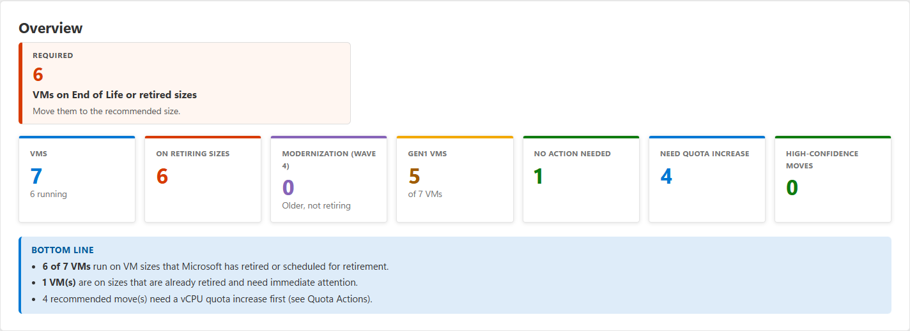
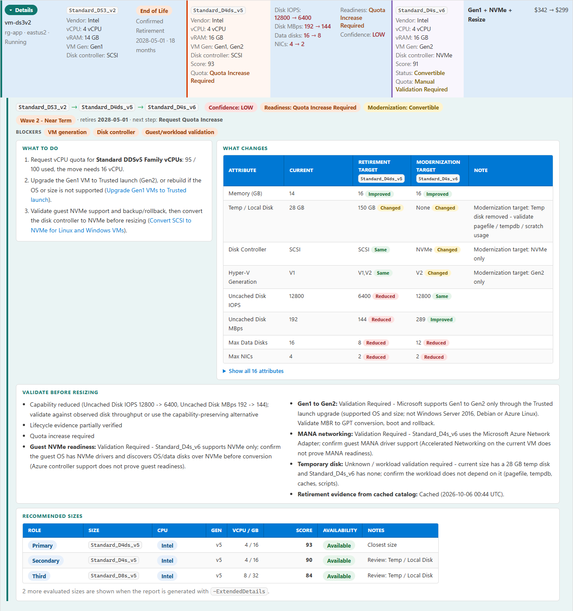

# Azure VM SKU Retirement Report

[](https://github.com/AzaryaShaulov/VMSKURetirementReport/actions/workflows/vm-sku-retirement-report-ci.yml)
[](LICENSE)


Find Azure VMs affected by Microsoft-announced VM size retirements, review replacement options, and plan migration
waves with regional availability and quota evidence. The assessment is **read-only**: it does not resize VMs, change
Azure configuration, or request quota increases.

It runs as a standalone PowerShell tool or an [Agent Skill](https://agentskills.io) for GitHub Copilot and other agents.
This guide starts with standalone PowerShell; see [use with Copilot](#use-with-copilot) or the
[detailed usage guide](docs/using-the-tool.md) for other workflows and options.

The tool scans every subscription you can read and recommends a compatible current-generation replacement for VMs on
retired or retiring sizes. It checks regional availability, subscription restrictions, and aggregated VM-family quota,
then produces an auditable migration-wave plan in HTML, Markdown, CSV, and JSON.

**Evidence and recommendations:** Retirement findings include Microsoft source links; uncertain lifecycle or platform
data is labelled for review. Candidates preserve CPU architecture, prioritize the same CPU vendor, and pass workload
compatibility checks for generation, storage, networking, security, and more. Quota demand is aggregated across VMs.
Normal retirement recommendations may use a flagged cross-vendor x64 fallback only when no valid same-vendor candidate
exists; the explicit v6/v7 modernization selection requires the same vendor. CPU vendor inferred from SKU naming is
partially verified and must be validated.

**Read-only:** Azure CLI reads collect inventory, SKU availability and restrictions, quota, and optional telemetry.
The tool never changes VM state or Azure configuration and never requests quota increases.

## Run it with PowerShell

You need Windows, PowerShell 7.2+, Azure CLI 2.60+, and Reader access to the subscriptions you want to assess.
The Azure CLI Resource Graph extension and network access to Azure and Microsoft Learn are also required. Rightsizing
telemetry is optional and requires Monitoring Reader.

Open PowerShell and paste this sequence. Replace `<tenant-id>` with your tenant ID. It downloads the current package,
checks the published SHA-256 checksum, extracts the tool, signs in, and creates the assessment in a new output folder.
Direct downloads: [ZIP](https://raw.githubusercontent.com/AzaryaShaulov/VMSKURetirementReport/main/dist/VMSKURetirementReport-v1.2.3-c.zip) ·
[SHA-256](https://raw.githubusercontent.com/AzaryaShaulov/VMSKURetirementReport/main/dist/VMSKURetirementReport-v1.2.3-c.zip.sha256).

```powershell
$version = '1.2.3-c'
$base = "https://raw.githubusercontent.com/AzaryaShaulov/VMSKURetirementReport/main/dist/VMSKURetirementReport-v$version"
$downloads = Join-Path $HOME 'Downloads'
Set-Location $downloads

Invoke-WebRequest "${base}.zip" -OutFile "VMSKURetirementReport-v$version.zip"
Invoke-WebRequest "${base}.zip.sha256" -OutFile "VMSKURetirementReport-v$version.zip.sha256"

$actual = (Get-FileHash ".\VMSKURetirementReport-v$version.zip" -Algorithm SHA256).Hash.ToLowerInvariant()
$expected = (Get-Content ".\VMSKURetirementReport-v$version.zip.sha256").Split()[0]
if ($actual -ne $expected) { throw 'Package checksum verification failed. Do not extract or run the ZIP.' }
Write-Host 'Package checksum verified.' -ForegroundColor Green

Unblock-File ".\VMSKURetirementReport-v$version.zip"
Expand-Archive ".\VMSKURetirementReport-v$version.zip" -DestinationPath 'C:\Tools\VMSKURetirementReport' -Force

az login --tenant '<tenant-id>'
az extension add --name resource-graph

$script = 'C:\Tools\VMSKURetirementReport\vm-sku-retirement-report\scripts\Invoke-VMSKURetirementReport.ps1'
& $script -OutputPath 'C:\Reports\vm-sku\assessment'
Invoke-Item 'C:\Reports\vm-sku\assessment\index.html'
```

Use a new or empty `-OutputPath` for each run. Add `--check-modernization` to assess optional v6/v7 paths. For example,
to assess two subscriptions in selected regions and include modernization:

```powershell
& $script `
  -SubscriptionId '11111111-1111-1111-1111-111111111111','33333333-3333-3333-3333-333333333333' `
  -Region eastus2,westus3 `
  --check-modernization `
  -OutputPath 'C:\Reports\vm-sku\scoped-assessment'
Invoke-Item 'C:\Reports\vm-sku\scoped-assessment\index.html'
```

To replay a previous assessment without re-reading Azure inventory, availability, or quota (and without online pricing):

```powershell
& $script -SaveSnapshot -OutputPath 'C:\Reports\vm-sku\capture'
& $script -FromSnapshot 'C:\Reports\vm-sku\capture' --check-modernization -SkipPricing `
  -OutputPath 'C:\Reports\vm-sku\replay'
```

The snapshot contains a copy of estate inventory; protect it like the report. Replay uses captured availability and
quota data, which may be stale. See the [full parameter reference and examples](docs/using-the-tool.md#common-options).

> **Before running:** `az login` updates your local Azure CLI sign-in cache. The assessment itself uses read-only Azure
> operations. Never share generated reports publicly: they contain tenant, subscription, VM identifiers, and possibly
> resource names.

## Start with these report files

| Open this | To see |
|---|---|
| `index.html` | Estate summary, migration waves, affected subscriptions, and Microsoft evidence |
| `<subscription>-<id>.html` | Per-VM replacement details, validation items, readiness, and quota impact |
| `executive-summary.md` | A quick text summary of findings and migration waves |
| `vm-assessment.csv` | One row per VM for Excel or Power BI |
| `quota-impact.csv` | Aggregated quota demand and suggested increases by scope |
| `assessment.json` | Complete structured results; see the [schema](skills/vm-sku-retirement-report/references/output-schema.md) |

HTML focuses on VMs requiring action; CSV, JSON, and Markdown include every VM. A recommendation is not a guarantee of
physical capacity or a successful resize. Verify workload compatibility and validation items before making production
changes. Each subscription HTML report also summarizes affected VM counts by current SKU and lifecycle status. See
[how to interpret the results](docs/using-the-tool.md#read-the-results).





## Use with Copilot

Install the Agent Skill from the repository:

```powershell
npx skills add https://github.com/AzaryaShaulov/VMSKURetirementReport/tree/main/skills/vm-sku-retirement-report -a github-copilot
```

Then ask Copilot: **“Run the VM SKU retirement assessment for this tenant and give me the HTML report.”**
See the [skill instructions](skills/vm-sku-retirement-report/SKILL.md) for prerequisites, installation choices, and
agent workflow.

## More information

- [Detailed PowerShell usage, options, outputs, and limitations](docs/using-the-tool.md)
- [Frequently asked questions](docs/faq.md)
- [Synthetic sample report](examples/sample-report/index.html)
- [Data sources and permissions](skills/vm-sku-retirement-report/references/data-sources.md)
- [Assessment methodology](skills/vm-sku-retirement-report/references/methodology.md) and [scoring](skills/vm-sku-retirement-report/references/scoring.md)
- [Contributing and development](CONTRIBUTING.md)
- [Support](SUPPORT.md) · [Security reporting](SECURITY.md)

## Disclaimer

This independently developed tool is provided “AS IS” and is not an official Microsoft product or Microsoft-supported
solution. Findings are informational: independently verify retirement evidence, SKU compatibility, availability,
quota, pricing, and migration requirements before acting. Users are responsible for validating and executing any
production changes. See the [MIT license](LICENSE) and [third-party notices](THIRD-PARTY-NOTICES.md).
