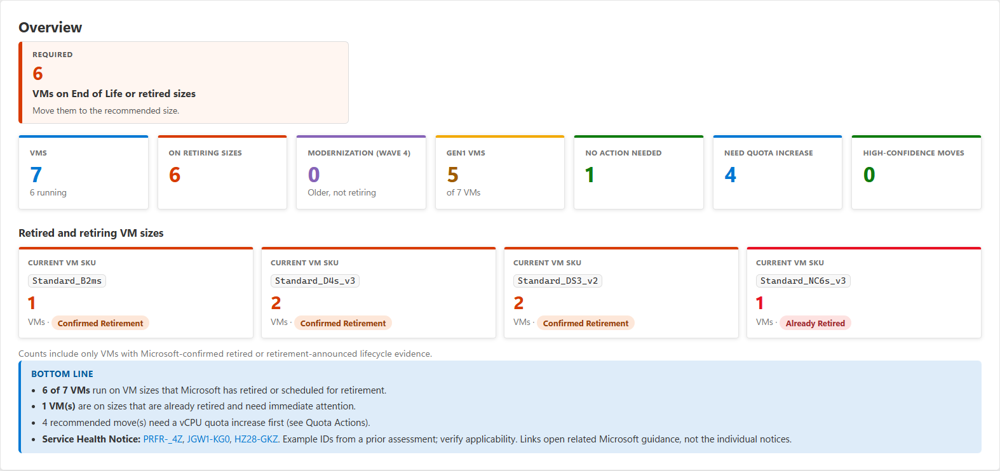
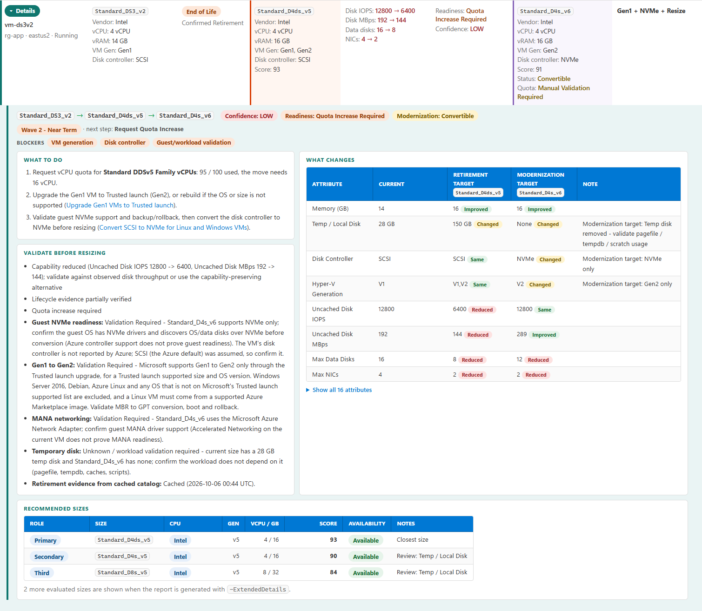

# Azure VM SKU Retirement Report

[](https://github.com/AzaryaShaulov/VMSKURetirementReport/actions/workflows/vm-sku-retirement-report-ci.yml)
[](LICENSE)


Find Azure VMs affected by Microsoft-announced VM size retirements (related Service Health IDs:
[`PRFR-_4Z`](https://learn.microsoft.com/en-us/azure/virtual-machines/sizes/lifecycle/retirements-and-capacity-restrictions),
[`JGW1-KG0`](https://learn.microsoft.com/en-us/azure/service-health/overview), and
[`HZ28-GKZ`](https://learn.microsoft.com/en-us/azure/cost-management-billing/reservations/manage-legacy-vm-reservations-after-july-1-2026)).
Review replacement options and plan migration waves with regional availability and quota evidence. The assessment is
**read-only**: it does not resize VMs, change Azure configuration, or request quota increases.

These example IDs were observed in a prior assessment: the first concerns retirement and pricing, the second regional
pricing, and the third Reserved Instance eligibility. The links open related Microsoft guidance, **not the individual
notices**. Applicability varies by subscription; check the full notices in Azure Service Health.

It runs as a standalone PowerShell tool or an [Agent Skill](https://agentskills.io) for GitHub Copilot and other agents.
This guide starts with standalone PowerShell; see [use with Copilot](#use-with-copilot) or the
[detailed usage guide](docs/using-the-tool.md) for other workflows and options.

The tool scans every subscription you can read and recommends a compatible current-generation replacement for VMs on
retired or retiring sizes. It checks regional availability, subscription restrictions, and aggregated VM-family quota,
then produces an auditable migration-wave plan in HTML, Markdown, CSV, and JSON.

**Evidence and recommendations:** Retirement findings include Microsoft source links; uncertain lifecycle or platform
data is labelled for review. Candidates preserve CPU architecture, prioritize the same CPU vendor, and pass workload
compatibility checks for generation, storage, networking, security, and more. Quota demand is aggregated across VMs.
Normal retirement recommendations may use a flagged cross-vendor x64 fallback only when no valid same-vendor candidate
exists; the explicit v6/v7 modernization selection requires the same vendor. CPU vendor inferred from SKU naming is
partially verified and must be validated.

**Read-only:** Azure CLI reads collect inventory, SKU availability and restrictions, quota, and optional telemetry.
The tool never changes VM state or Azure configuration and never requests quota increases.

## Run it with PowerShell

Before you start, make sure you have:

- Windows, [PowerShell 7.2 or newer](https://learn.microsoft.com/en-us/powershell/scripting/install/installing-powershell-on-windows)
  and [Azure CLI 2.60 or newer](https://learn.microsoft.com/en-us/cli/azure/install-azure-cli-windows).
- Reader access to the subscriptions you want to assess, plus network access to Azure and Microsoft Learn.
- The Azure CLI Resource Graph extension; step 3 shows how to check for it.

Rightsizing telemetry is optional and requires Monitoring Reader.

### 1. Download the tool

Save both files to your **Downloads** folder:

- [Download the tool ZIP](https://raw.githubusercontent.com/AzaryaShaulov/VMSKURetirementReport/main/dist/VMSKURetirementReport-v1.2.3-c.zip)
- [Download its SHA-256 checksum](https://raw.githubusercontent.com/AzaryaShaulov/VMSKURetirementReport/main/dist/VMSKURetirementReport-v1.2.3-c.zip.sha256)

If the checksum opens as text in your browser, right-click its link and choose **Save link as**. Keep the downloaded
file names unchanged.

### 2. Verify and extract

Open **PowerShell 7** and paste this block. It checks the ZIP before extracting it to a `VMSKURetirementReport` folder
in your user profile. If the checksum does not match, it stops without extracting.

```powershell
& {
    $ErrorActionPreference = 'Stop'
    $zip = Join-Path $HOME 'Downloads\VMSKURetirementReport-v1.2.3-c.zip'
    $expected = (Get-Content -LiteralPath "$zip.sha256" -Raw).Trim().Split()[0]
    if ((Get-FileHash -LiteralPath $zip -Algorithm SHA256).Hash -ne $expected) {
        throw 'Checksum verification failed. Do not extract or run the ZIP.'
    }
    Unblock-File -LiteralPath $zip
    Expand-Archive -LiteralPath $zip -DestinationPath (Join-Path $HOME 'VMSKURetirementReport')
    Write-Host 'Package verified and extracted.'
}
```

If a file is missing or verification fails, download both files again. If you saved them outside **Downloads**, update
the ZIP path in the block. Choose a different extraction folder if the destination already contains files; if you change
it, update the script path in step 4 as well.

### 3. Sign in

Replace `<tenant-id>` with your Azure tenant ID. Continue only after sign-in succeeds and the displayed tenant is the one
you want to assess.

```powershell
az login --tenant '<tenant-id>'
az account show --query "{Tenant:tenantId,Subscription:name}" --output table
az extension list --output table
```

If `resource-graph` is not in the extension list, install it locally:

```powershell
az extension add --name resource-graph
```

### 4. Create and open the report

Run this in the same PowerShell window. By default, the tool assesses all subscriptions you can read in the signed-in
tenant. The report goes into `VMSKU-Reports\assessment` in your user profile. Choose a new or empty output folder for
each run.

```powershell
$script = Join-Path $HOME 'VMSKURetirementReport\vm-sku-retirement-report\scripts\Invoke-VMSKURetirementReport.ps1'
$output = Join-Path $HOME 'VMSKU-Reports\assessment'
& $script -OutputPath $output
```

After the assessment completes successfully, open the report:

```powershell
Invoke-Item (Join-Path $output 'index.html')
```

The report opens in your browser. To select subscriptions or regions, or enable optional v6/v7 modernization, use the
examples below.

### Optional: scope or replay an assessment

Add `--check-modernization` to assess optional v6/v7 paths. For example, to assess two subscriptions in selected regions
and include modernization:

```powershell
& $script `
  -SubscriptionId '11111111-1111-1111-1111-111111111111','33333333-3333-3333-3333-333333333333' `
  -Region eastus2,westus3 `
  --check-modernization `
  -OutputPath (Join-Path $HOME 'VMSKU-Reports\scoped-assessment')
Invoke-Item (Join-Path $HOME 'VMSKU-Reports\scoped-assessment\index.html')
```

To replay a previous assessment without re-reading Azure inventory, availability, or quota (and without online pricing):

```powershell
& $script -SaveSnapshot -OutputPath (Join-Path $HOME 'VMSKU-Reports\capture')
& $script -FromSnapshot (Join-Path $HOME 'VMSKU-Reports\capture') --check-modernization -SkipPricing `
  -OutputPath (Join-Path $HOME 'VMSKU-Reports\replay')
```

The snapshot contains a copy of estate inventory; protect it like the report. Replay uses captured availability and
quota data, which may be stale. See the [full parameter reference and examples](docs/using-the-tool.md#common-options).

> **Before running:** `az login` updates your local Azure CLI sign-in cache. The assessment itself uses read-only Azure
> operations. Never share generated reports publicly: they contain tenant, subscription, VM identifiers, and possibly
> resource names.

## Start with these report files

| Open this | To see |
|---|---|
| `index.html` | Estate summary, migration waves, affected subscriptions, and Microsoft evidence |
| `<subscription>-<id>.html` | Per-VM replacement details, validation items, readiness, and quota impact |
| `executive-summary.md` | A quick text summary of findings and migration waves |
| `vm-assessment.csv` | One row per VM for Excel or Power BI |
| `quota-impact.csv` | Aggregated quota demand and suggested increases by scope |
| `assessment.json` | Complete structured results; see the [schema](skills/vm-sku-retirement-report/references/output-schema.md) |

HTML focuses on VMs requiring action; CSV, JSON, and Markdown include every VM. A recommendation is not a guarantee of
physical capacity or a successful resize. Verify workload compatibility and validation items before making production
changes. Each subscription HTML report also summarizes affected VM counts by current SKU and lifecycle status. See
[how to interpret the results](docs/using-the-tool.md#read-the-results).





## Use with Copilot

Install the Agent Skill from the repository:

```powershell
npx skills add https://github.com/AzaryaShaulov/VMSKURetirementReport/tree/main/skills/vm-sku-retirement-report -a github-copilot
```

Then ask Copilot: **“Run the VM SKU retirement assessment for this tenant and give me the HTML report.”**
See the [skill instructions](skills/vm-sku-retirement-report/SKILL.md) for prerequisites, installation choices, and
agent workflow.

## More information

- [Detailed PowerShell usage, options, outputs, and limitations](docs/using-the-tool.md)
- [Frequently asked questions](docs/faq.md)
- [Synthetic sample report](examples/sample-report/index.html)
- [Data sources and permissions](skills/vm-sku-retirement-report/references/data-sources.md)
- [Assessment methodology](skills/vm-sku-retirement-report/references/methodology.md) and [scoring](skills/vm-sku-retirement-report/references/scoring.md)
- [Recommendation logic and scoring flow (SVG)](docs/images/recommendation-logic.svg)
- [Contributing and development](CONTRIBUTING.md)
- [Support](SUPPORT.md) · [Security reporting](SECURITY.md)

## Disclaimer

This independently developed tool is provided “AS IS” and is not an official Microsoft product or Microsoft-supported
solution. Findings are informational: independently verify retirement evidence, SKU compatibility, availability,
quota, pricing, and migration requirements before acting. Users are responsible for validating and executing any
production changes. See the [MIT license](LICENSE) and [third-party notices](THIRD-PARTY-NOTICES.md).
